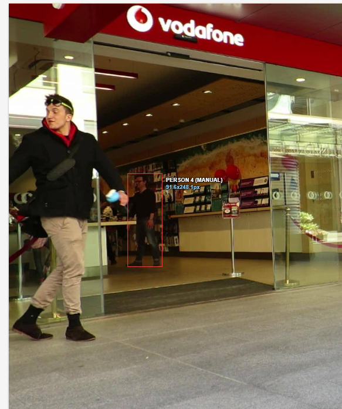
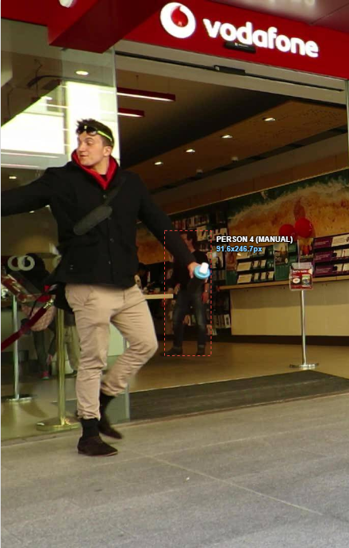
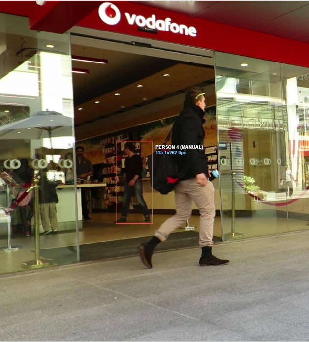

# Báo cáo cá nhân — HoVaTen-MSSV

Đổi tên file theo quy tắc `MSSV_HoTen.md`. Ví dụ: `20241234_NguyenVanAn.md`.

Đoạn video: MOT17-09, 150 frame (frame 1–150), nguồn MOTChallenge, giấy phép CC BY-NC-SA 3.0.

## 0. Thông tin học viên

- Họ tên:Pham Thanh Tùng                
- MSSV: 202603159       
- Mã đề (A/B/C):A
- Email:tungpham1824@gmail.com  
- Link repository:https://github.com/tungpham1824/K5-L2-Day05-PhamThanhTung-03519-MOTTracking.git
- Giờ bắt đầu: 16h30    
- Giờ kết thúc:18h

## 1. Xem trước đoạn video (CP0)

Ghi **trước khi vẽ**, mỗi người một dòng.

| Mã | Frame xuất hiện | Frame cuối thấy được | Rẽ / dừng / đổi tốc độ ở frame | Bị che ở frame | Ghi chú |
|---|---|---|---|---|---|
| P1 |0 |150 | |38| |
| P2 |61 |149|61| | |
| P3 |0 |149 | | | |
| P4 |40 |149 | | | |
| P5 |0 |144 |42 |107 | |

## 2. Keyframe và thời gian (CP1, CP4)

Số keyframe lấy từ kết quả `src/check_submission.py`.

| Mã | Số keyframe | Keyframe ở frame | Số frame có mặt | Keyframe / 100 frame | Thời gian (phút) | Chỗ khó |
|---|---|---|---|---|---|---|
| P1 |	16 |0, 10, 20, 27, 30, 37, 47, 52, 54, 66, 76, 96, 106, 126, 136, 146 |144 |11,1 | | |
| P2 |10 |0, 10, 20, 30, 40, 106, 136, 140, 141, 143 |122 |8,2 | | |
| P3 |	16 |0, 10, 20, 30, 42, 52, 62, 72, 82, 92, 102, 112, 122, 132, 142, 149 |150 |	10,7 | | |
| P4 |	12 |39, 49, 59, 69, 79, 89, 99, 109, 119, 129, 139, 149 |111 |10,8 | | |
| P5 | 11| |60, 70, 72, 81, 91, 101, 111, 121, 131, 141, 149 |90 |12,2 | |
| **Tổng** |65 |617 |10,5 | | | |

Keyframe / 100 frame của cả bài = tổng keyframe ÷ tổng số frame có mặt × 100 = 10,5.

Bạn đặt keyframe nhiều nhất ở người nào? Vì sao (người đó rẽ, dừng, lại gần camera hay bị che)?

key frame nhiều nhất ở person 1 ,vì bị che

## 3. Đoạn bị che (CP2)

Người bị che: `P1`

| Mốc | Frame |
|---|---:|
| Bắt đầu bị che một phần (bật `occluded`) |27 |
| Mất hẳn (bật `outside`) |41 |
| Hiện lại (tắt `outside`) |47|
| Thấy rõ trở lại (tắt `occluded`) |54 |

- Thời gian khuất hẳn: 6 frame = 0.2 giây.
- Quyết định: giữ cùng ID
- Lý do :Khuất hẳn chỉ 6 frame, rất ngắn so với ngưỡng 60 frame (2 giây) nên theo quy ước của lớp là cùng một người.Ngoại hình trước và sau khi che có khớp .Chỗ hiện lại có đúng hướng và tốc độ so với trước khi che.

...

Ảnh chụp màn hình:

## 4. Tự review ID (CP3)

Lượt 1 theo người (đi ngược từ frame 149 về 0 trên CVAT), lượt 2 theo cảnh (nhảy 10 frame). Ít nhất 3 dòng; không có lỗi thì ghi một dòng "đã kiểm hai lượt, không lỗi".

Loại lỗi dùng đúng một trong 7 mã: `id_switch`, `fragmentation`, `lost`, `merge`, `false_track`, `drift`, `flag`.

| Frame | Mã người | Loại lỗi | Mô tả một câu | Phát hiện ở lượt | Đã sửa? |
|---:|---|---|---|---|---|
| | | |Đã kiểm hai lượt (lượt 1 theo từng người, lượt 2 theo cảnh), không lỗi	 |1 và 2 | |
| | | | | | |
| | | | | | |

Tổng hợp số lỗi theo loại:

| `id_switch` | `fragmentation` | `lost` | `merge` | `false_track` | `drift` | `flag` |
|---:|---:|---:|---:|---:|---:|---:|
|0 |0 | 0|0 |0 |0 |0 |

## 5. File xuất và kết quả tự kiểm (CP4)

| Kiểm tra | Kết quả |
|---|---|
| Tên file MOT 1.1 |	PhamThanhTung_mot.zip |
| Tên file CVAT for video 1.1 |	PhamThanhTung_cvat_video.zip |
| Số track ID khác nhau trong `gt/gt.txt` (phải là 5) |5 |
| Frame `outside` không có dòng trong `gt.txt` (đúng / sai) |đúng |
| Job đã completed trên CVAT máy cá nhân |có |

Dán phần tóm tắt in ra từ `src/check_submission.py`:

.\.venv\Scripts\python.exe src/check_submission.py --mot src/exports/PhamThanhTung_mot.zip --cvat src/exports/PhamThanhTung_cvat_video.zip
Số frame in theo CVAT (bắt đầu từ 0). Trong gt.txt, frame_id = frame CVAT + 1.

=== File MOT 1.1: PhamThanhTung_mot.zip ===
  Số track ID: 5   |   Tổng số box: 617
  [OK]        Đúng 5 track ID.

  Track | Frame có mặt | Số frame | Đoạn vắng (outside)
      1 |   0–149      |      150 | -
      2 |   0–149      |      144 | 41–46
      3 |   0–146      |      122 | 111–135
      4 |  39–149      |      111 | -
      5 |  60–149      |       90 | -

=== File CVAT for video 1.1: PhamThanhTung_cvat_video.zip ===

  Track | Nhãn   | Frame thấy | Keyframe | KF/100 frame | Frame occluded | Lần bật outside
      0 | person |        150 |       16 |         10.7 |              0 |               0
              Track 0: keyframe ở frame [0, 10, 20, 30, 42, 52, 62, 72, 82, 92, 102, 112, 122, 132, 142, 149]
      1 | person |        144 |       16 |         11.1 |             14 |               1
              Track 1: keyframe ở frame [0, 10, 20, 27, 30, 37, 47, 52, 54, 66, 76, 96, 106, 126, 136, 146]
      2 | person |         90 |       11 |         12.2 |             10 |               0
              Track 2: keyframe ở frame [60, 70, 72, 81, 91, 101, 111, 121, 131, 141, 149]
      3 | person |        111 |       12 |         10.8 |              0 |               0
              Track 3: keyframe ở frame [39, 49, 59, 69, 79, 89, 99, 109, 119, 129, 139, 149]
      4 | person |        122 |       10 |          8.2 |             13 |               2
              Track 4: keyframe ở frame [0, 10, 20, 30, 40, 106, 136, 140, 141, 143]

  Tổng: 65 keyframe / 617 frame có mặt = 10.5 keyframe / 100 frame
  [OK]        Đọc được 5 track từ annotations.xml.

=== Tóm tắt ===
  Lỗi: 0   |   Cảnh báo: 0
  Đạt. Dán phần tóm tắt này vào báo cáo mục 5.

## 6. Ba câu kết

1. Nếu được gán lại, bạn sẽ đặt keyframe khác ở đâu? Vì sao?

Tôi sẽ thêm 1–2 keyframe cho P5 trong đoạn frame 40–106. Ở đó chỉ có keyframe ở frame 40 rồi nhảy sang 106 (66 frame), trong khi nội suy tuyến tính giả định người đi với vận tốc không đổi, nên nếu P5 đổi tốc độ hoặc đổi hướng (tôi đã ghi P5 đổi tốc độ ở khoảng frame 42) thì box dễ trôi khỏi người. Ngược lại, với P3 đi thẳng đều tôi có thể thưa hơn mỗi 10 frame, ví dụ 15–20 frame, mà box vẫn khớp.

2. Có chỗ nào bạn không chắc "cùng ID hay ID mới"? Bạn đã quyết định và ghi chú thế nào?

 Chỗ tôi cân nhắc nhiều nhất là P5 vắng 25 frame (111–135, khoảng 0,83 giây) rồi xuất hiện lại. Khoảng vắng này ngắn hơn ngưỡng 60 frame (2 giây) của lớp nên tôi giữ cùng ID: bật outside ở frame 111, tắt ở frame hiện lại rồi chỉnh box thành keyframe mới, không tạo track mới. Với P1 bị P2 che (khuất hẳn 6 frame, 41–46) tôi cũng giữ cùng ID theo cùng quy ước, và ghi 4 mốc frame vào mục 3.

3. Một lỗi ID trong job của bạn (nếu không còn sót, chọn lỗi đã sửa) có thể làm xe tự lái dự đoán sai chuyển động của người đó như thế nào? Lỗi đó ảnh hưởng MOTA hay IDF1 nhiều hơn?

   Trong job của tôi không còn id_switch, nhưng nếu ở lúc P2 che P1 (frame 41–47) mà ID của P1 bị chuyển sang P2 thì quỹ đạo của hai người bị nối chéo nhau. Và xe tự lái dùng quỹ đạo đó sẽ dự đoán sai hướng và tốc độ của người đi bộ. Lỗi này ảnh hưởng IDF1 nhiều hơn MOTA: MOTA chỉ trừ một đơn vị cho mỗi lần đổi ID, còn IDF1 đo độ nhất quán định danh dọc cả quỹ đạo nên giảm mạnh khi ID bị đổi giữa chừng.

## Bonus (nếu làm)

### B1 — Hai người đi sát

...

### B2 — So cách đặt keyframe

| Cách đặt | Số keyframe | Frame trôi nhất | Ghi chú |
|---|---:|---:|---|
| Đều mỗi 30 frame | | | |
| Theo chỗ đổi hướng | | | |

...

### B3 — So với tracker có sẵn

| Frame | Mã người | Tracker làm gì | Nhãn của bạn | Giải thích (đoán rồi sửa / ghép IoU / box score thấp / ngoại hình) |
|---:|---|---|---|---|
| | | | | |
| | | | | |

## 7. Tài liệu tham khảo và công cụ AI đã dùng

...
